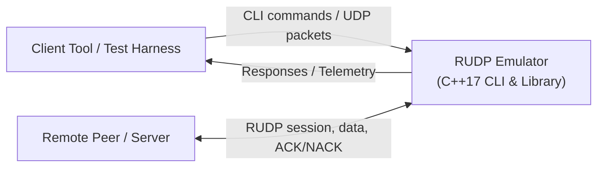
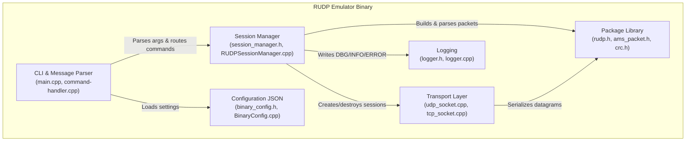
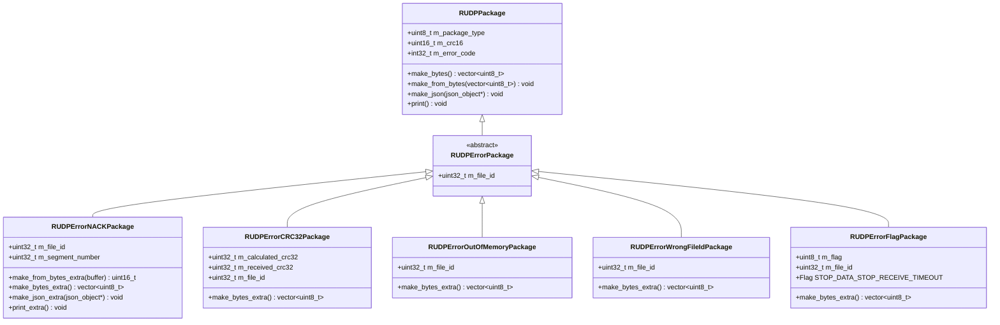

# C4 Architecture Diagrams – RUDP Emulator

## 1. Context Diagram (Level 0)

**Description:** The emulator sits as a stand-alone binary that communicates with external entities (client tools, test harnesses, or other systems) via a command-socket and/or UDP packets. It can act as both client and server depending on the invoked mode.

---

## 2. Container Diagram (Level 1)

**Description:** The binary is decomposed into logical containers that each own a set of responsibilities. The Package Library is the core of the RUDP protocol, handling framing, CRC16/32, seven-bit encoding, and error-type packages.

---

## 3. Component Diagram (Level 2) – Package Hierarchy

**Description:** The package class hierarchy follows the template method pattern. The base RUDPPackage defines the common serialization flow (make_bytes), CRC generation, and JSON conversion.
