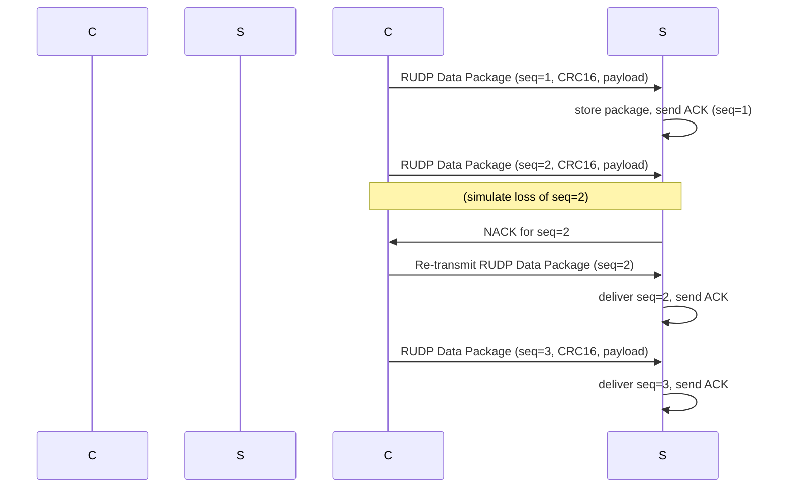
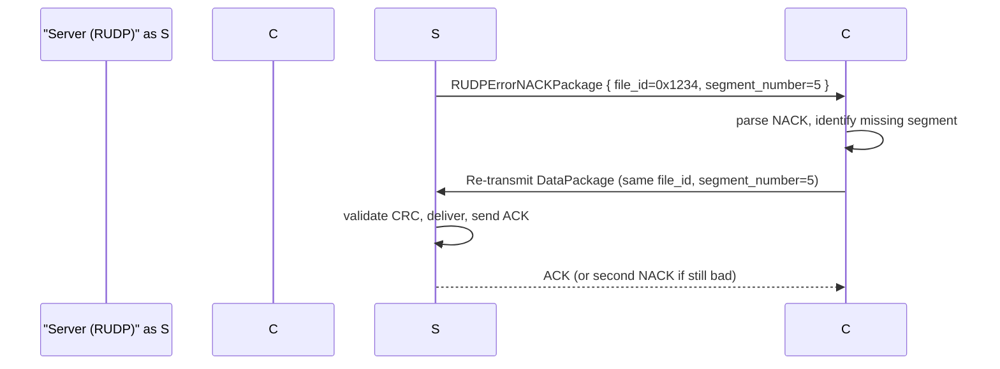

# Protocol Specification & Sequence Diagrams

## 1. RUDP Packet Format

A RUDP packet consists of a **fixed header** followed by an **optional extra block** that is specific to the package type.

```
+-------------------------------+----------------+-----------------------+
|        Fixed Header (4 bytes) |  CRC16 (2 bytes) |   Error Code (4 bytes)|
+-------------------------------+----------------+-----------------------+
| Package Type (1 byte) | Reserved (3 bits) | ...
+-----------------------------------------------+
| Optional Extra Block (variable length)           |
+-----------------------------------------------+
```

### Fixed Header Details
| Byte(s) | Field | Description |
|---------|-------|-------------|
| 0 | **m_package_type** | 8‑bit identifier that dispatches to the appropriate subclass handler (e.g., data, NACK, error, control). |
| 1‑3 | **Reserved** | Must be zero for forward compatibility; recipients may ignore. |

### CRC16
- 2‑byte (16‑bit) checksum computed over the preceding bytes (package type + optional extra block). Used by the receiver to detect corruption.

### Error Code
- 32‑bit integer. Values are defined in `constants.h` and convey success, generic error, out‑of‑memory, wrong file id, etc.

### Optional Extra Block
Each package type defines its own extra fields after the fixed header. The most common extra blocks are:

| Package Type | Extra Fields (in order) | Encoding |
|--------------|------------------------|----------|
| **RUDPErrorNACKPackage** | `m_file_id` (uint32_t) , `m_segment_number` (uint32_t) | Seven‑bit encoded integers, MSB first |
| **RUDPErrorCRC32Package** | `m_calculated_crc32` (uint32_t), `m_received_crc32` (uint32_t), `m_file_id` (uint32_t) | Seven‑bit encoded, MSB first |
| **RUDPErrorFlagPackage** | `m_flag` (uint8_t) – defines action: 1 = client stops data transfer, 2 = server stops data reception, 3 = client connection timeout, 4 = server connection timeout; `m_file_id` (uint32_t) | Single byte flag + seven‑bit file id |
| **Plain Data Package** (not shown in snippet) | Payload length + payload bytes | Length prefix (uint16_t) followed by raw bytes |

#### Seven‑bit Encoding (common utility)
- Each byte uses the lower 7 bits for data; the MSB indicates whether another byte follows (1 = more bytes, 0 = last byte).
- Used for encoding `file_id`, `segment_number`, `error_code`, and other integer fields that may be large but are typically < 2 GB.

#### Example: Serialising a NACK package
```text
+----+----+----+----+----+----+----+----+
| PT | 0  | 0  | 0  | FileId byte 1 | ... | FileId byte n |
+----+----+----+----+----------------+-------+
| CRC16 low | CRC16 high | ErrorCode low | ... | ErrorCode high |
+-------------------------------------------------+
| Seven‑bit SegmentNumber byte 1 | ... | Seven‑bit SegmentNumber byte m |
+-------------------------------------------------+
```

---

## 2. Sequence Diagrams (Mermaid)

### 2.1 Connection Establishment (Client → Server)

```mermaid
sequenceDiagram
    participant "Client" as C
    participant "Server (RUDP Emulator)" as S
    C->>S: send "connect" CLI command (or initiate UDP handshake)
    S->>S: create RUDPSession (owner = client)
    S-->>C: ACK with session_id & configuration (JSON)
    C->>S: send data packages (encrypted/serialized)
    note right of C: each package includes m_package_type, CRC16, optional extra fields
    note left of S: receiver validates CRC, dispatches to handler,
                      sends NACK if packet lost or corrupted
```

*Key points:*  
- The client may start by sending a textual `"connect"` command through the command‑socket; the server creates an internal session and returns a JSON‑encoded acknowledgment containing a `session_id` and optional parameters (e.g., `window_size`, `retransmit_timeout`).  
- After the handshake, all data is exchanged as RUDP packages over UDP.  
- The server tracks sequence numbers internally; if a package is not received within the timeout, it sends a NACK (see below).

---

### 2.2 Data Transfer & Retransmission on Loss



*Key points:*  
- Each data package carries a monotonically increasing sequence number (implicit in the transport or explicit via extra fields).  
- The receiver sends an ACK immediately upon successful CRC validation and payload delivery.  
- If a package is lost (no ACK within `retransmit_timeout`), the sender receives a **NACK** (implemented as `RUDPErrorNACKPackage`) containing the missing sequence number and/or file identifier.  
- Upon NACK, the sender re‑transmits the missing package; the receiver may deduplicate if the package arrives again.

---

### 2.3 NACK‑Driven Retransmission (Detailed)



*Key points:*  
- The NACK package is the primary error‑reporting mechanism. It carries `file_id` (to associate with a logical stream) and `segment_number` (the exact missing piece).  
- The sender must look up the corresponding outgoing queue, re‑send the exact bytes, and optionally reset the retransmission timer.  
- If the re‑transmitted packet is also corrupted, the receiver may send another NACK or, after a configurable retry limit, tear down the session.

---
*All Mermaid diagrams can be rendered in any Markdown environment that supports Mermaid (GitHub, GitLab, VS Code with the extension, etc.). The protocol description is derived from the header files `rudp.h`, `ams_packet.h`, `ams_message.h`, `constants.h`, `crc.h`, and the implementation in `main.cpp`.*